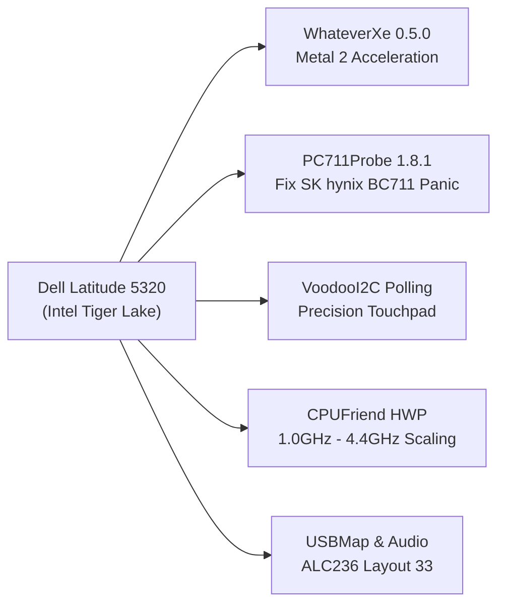

# Dell Latitude 5320 Hackintosh — macOS 15 Sequoia (OpenCore 1.0.8)

[](https://github.com/acidanthera/OpenCorePkg)
[](https://www.apple.com/macos/)
[]()
[-blueviolet.svg)](https://github.com/b00t0x/WhateverXe)
[-brightgreen.svg)](https://github.com/hrx114514x/PC711Probe)
[]()

Bộ cấu hình **OpenCore EFI 1.0.8** hoàn chỉnh, đã được thẩm định và vận hành thực tế trên dòng laptop doanh nhân **Dell Latitude 5320**. Hỗ trợ đầy đủ môi trường **macOS Sequoia (15.8.1 - Build 24H32)** và **macOS Sonoma (14.x)** với tính năng tăng tốc đồ họa phần cứng **Metal 2 (Intel Iris Xe)**, vá lỗi ổ cứng NVMe **SK hynix BC711**, bàn phím, touchpad đa điểm mượt mà và quản lý nguồn điện tối ưu.

---

## 1. Thông Số Phần Cứng & Trạng Thái Hoạt Động (Hardware Status)

### 1.1. Bảng cấu hình chi tiết

| Thành phần linh kiện | Thông số chi tiết phần cứng | Nhận diện macOS / Controller | Trạng thái hoạt động |
|---|---|---|:---:|
| **Model máy** | Dell Latitude 5320 Laptop | SMBIOS: `MacBookPro16,2` |  Hoạt động hoàn hảo |
| **CPU** | Intel Core i5-1145G7 (Tiger Lake-U) | 4 Cores / 8 Threads, 2.60 GHz (Turbo 4.40 GHz) |  Nhận đủ xung, HWP active |
| **Đồ họa (iGPU)** | Intel Iris Xe Graphics G7 (96 EUs) | `8086:9A49` (VRAM cấp phát động 1536 MB) |  **Tăng tốc Metal 2 mượt mà** |
| **Màn hình** | 13.3" IPS Anti-Glare Full HD | 1920 x 1080 @ 60.00Hz ARGB8888 |  Hiển thị sắc nét, 60 FPS |
| **Bộ nhớ RAM** | 8 GB / 16 GB LPDDR4x / DDR4 3200MHz | Bus 3200 MHz kênh đôi (Dual Channel) |  Nhận chuẩn tốc độ |
| **Ổ cứng NVMe** | **SK hynix BC711** NVMe SSD 512GB | `1C5C:174A` (`HFM512GD3JX013N`, FW `HPS1`) |  **Đã vá triệt để lỗi panic** |
| **Âm thanh (Audio)** | Realtek ALC3254 (ALC236) | `AppleALC.kext` (Layout ID: `alcid=33`) |  Loa trong, Mic & Jack 3.5mm OK |
| **Wi-Fi** | Intel Wi-Fi 6 AX201 (CNVi) | `8086:a0f0` (Giao diện ảo `en0` qua `itlwm`) |  Kết nối ổn định với HeliPort |
| **Bluetooth** | Intel AX201 Bluetooth | `8087:0026` (USB cổng nội bộ `HS10`) |  Nhận diện đầy đủ, kết nối tốt |
| **Bàn phím** | Bàn phím Dell chuẩn PS/2 | `VoodooPS2Controller` + `VoodooPS2Keyboard` |  Gõ tốt, phím Fn & đèn nền OK |
| **Touchpad** | Dell Precision Touchpad (I2C HID) | `VoodooI2C` + `VoodooI2CHID` (`-vi2c-force-polling`) |  **Cử chỉ đa điểm 1-2-3 ngón cực nhạy** |
| **Webcam** | Integrated_Webcam_HD | Cổng USB nội bộ `HS04` (`3141:27145`) |  FaceTime, Zoom, Photobooth OK |
| **Pin (Battery)** | 3-cell / 4-cell Li-ion | `SMCBatteryManager.kext` |  Báo chuẩn %, chu kỳ sạc, trạng thái AC |
| **Cổng kết nối USB** | USB 3.2 Gen 1 (Type-A) + Type-C / TB4 | `AppleUSBXHCI` (Bản đồ ánh xạ `USBMap.kext`) |  Tốc độ chuẩn USB 2.0 & SuperSpeed |
| **Cảm biến vân tay** | Broadcom 58200 Fingerprint | Cổng USB `HS05` (`2652:22595`) | ❌ Không hỗ trợ (Apple không hỗ trợ Touch ID ngoài) |

---

## 2. Các Đột Phá Kỹ Thuật Nổi Bật (Key Breakthroughs)



### 2.1. Đồ Họa Intel Iris Xe: Tăng Tốc Phần Cứng & Hỗ Trợ Metal 2
* **Bước đột phá:** Intel thế hệ 11 (Tiger Lake) vốn không được Apple hỗ trợ chính thức. Nhờ tích hợp kext chuyên sâu [`WhateverXe.kext`](https://github.com/b00t0x/WhateverXe) (phiên bản `0.5.0` bởi `b00t0x`) kết hợp cùng module `AppleIntelTGLCompat` và `AMFIPass.kext`, hệ thống đã kích hoạt thành công:
  - Khung kết xuất đồ họa **Metal 2** đầy đủ.
  - VRAM động lên đến **1536 MB**.
  - Độ phân giải gốc **Full HD 1080p @ 60Hz** mượt mà, loại bỏ hoàn toàn chế độ VESA giật lag.

### 2.2. Giải Cứu Ổ Cứng OEM SK hynix BC711 (`PC711Probe.kext`)
* **Vấn đề kinh điển:** Ổ cứng `SK hynix BC711` (`1C5C:174A`) đi kèm máy Dell thường gây lỗi treo timeout trong driver `AppleNVMeController`, dẫn tới Kernel Panic ngay sau mốc `[EB|#LOG:EXITBS:START]` khiến người dùng không thể cài macOS.
* **Giải pháp:** Tích hợp trực tiếp [`PC711Probe.kext`](https://github.com/hrx114514x/PC711Probe) phiên bản `v1.8.1` cùng boot-arg `-pc711pdbg`, giúp kiểm soát hàng đợi ngắt MSI-X, đảm bảo tốc độ đọc/ghi NVMe chuẩn PCIe Gen3 x4 ổn định dài lâu.

### 2.3. Touchpad Đa Điểm Siêu Mượt (`-vi2c-force-polling`)
* Bộ điều khiển touchpad giao tiếp I2C HID được điều khiển bởi hệ thống `VoodooI2C` + `VoodooI2CHID`.
* Bổ sung cờ `-vi2c-force-polling` giúp khắc phục triệt để hiện tượng rớt ngắt tín hiệu APIC/GPIO trên bo mạch Dell, đem lại cảm giác di chuột mượt mà, phản hồi tức thì và hỗ trợ trọn vẹn các cử chỉ macOS (cuộn trang tự nhiên, vuốt 3 ngón, phóng to thu nhỏ).

### 2.4. Quản Lý Nguồn CPU Tiger Lake Tối Ưu (HWP Speed Shift)
* Kết hợp `CPUFriend.kext` và bảng dữ liệu tùy chỉnh `CPUFriendDataProvider.kext`, thiết lập xung sàn 1.0 GHz và trần 4.4 GHz. Quản lý năng lượng tự động thích ứng giúp máy mát mẻ khi làm việc nhẹ và bung hết hiệu năng khi xử lý tác vụ nặng.

---

## 3. Cấu Trúc Thư Mục EFI Chuẩn

```text
EFI/
├── BOOT/
│   └── BOOTx64.efi
└── OC/
    ├── ACPI/
    │   └── SSDT-EC-USBX-LAPTOP.aml          # Tạo thiết bị giả lập EC & cấp nguồn USB
    ├── Drivers/
    │   ├── HfsPlus.efi                      # Driver đọc phân vùng macOS HFS+
    │   ├── OpenCanopy.efi                   # Giao diện đồ họa OpenCore (tùy chọn)
    │   ├── OpenRuntime.efi                  # Driver runtime cốt lõi OpenCore
    │   ├── ResetNvramEntry.efi              # Tiện ích xóa nhanh biến NVRAM
    │   └── ToggleSipEntry.efi               # Tiện ích bật/tắt nhanh SIP
    ├── Kexts/
    │   ├── Lilu.kext (v1.6.8)               # Kext nền tảng
    │   ├── CPUFriend.kext (v1.2.9)          # Tối ưu hóa xung nhịp CPU
    │   ├── CPUFriendDataProvider.kext       # Bảng vector tần số CPU Tiger Lake
    │   ├── VirtualSMC.kext                  # Giả lập Apple SMC
    │   ├── WhateverXe.kext (v0.5.0)         # Driver tăng tốc iGPU Intel Iris Xe
    │   ├── AMFIPass.kext                    # Vượt qua rào cản AMFI trên macOS 15
    │   ├── PC711Probe.kext (v1.8.1)         # Bản vá lỗi NVMe SK hynix BC711
    │   ├── AppleALC.kext (v1.9.8)           # Quản lý âm thanh Realtek ALC236
    │   ├── SMCBatteryManager.kext           # Giám sát trạng thái pin
    │   ├── VoodooPS2Controller.kext         # Bàn phím PS/2 & phím Fn
    │   ├── VoodooI2C.kext + plugins         # Core xử lý Touchpad I2C
    │   ├── VoodooI2CHID.kext                # Driver vệ tinh cho Touchpad HID
    │   ├── itlwm.kext                       # Driver Wi-Fi Intel cho Sequoia
    │   ├── USBMap.kext                      # Bảng định tuyến cổng USB chuẩn hóa
    │   ├── XHCI-unsupported.kext            # Hỗ trợ mở rộng XHCI chipset Intel
    │   ├── BlueToolFixup.kext               # Bản vá ngăn xếp Bluetooth macOS 15
    │   ├── IntelBTPatcher.kext              # Vá lỗi firmware Bluetooth
    │   └── IntelBluetoothFirmware.kext      # Firmware nạp cho Intel Bluetooth
    ├── OpenCore.efi
    └── config.plist
```

---

## 4. Thiết Lập BIOS Khuyến Nghị (Dell Latitude 5320)

Khởi động máy và nhấn liên tục phím **`F2`** để vào Dell BIOS Setup (đã kiểm tra trên BIOS `1.52.0`):

* **System Configuration:**
  - `SATA / NVMe Operation`: **`AHCI / NVMe`** *(BẮT BUỘC — Không để RAID On)*.
  - `Enable Camera`: **Enabled**.
* **Security:**
  - `Secure Boot`: **Disabled** *(BẮT BUỘC)*.
  - `Intel SGX`: **Disabled**.
* **Pre-boot Behavior:**
  - `Fastboot`: **`Thorough`** *(Giúp BIOS nạp đầy đủ thiết bị phần cứng trước khi boot)*.
* **Virtualization Support:**
  - `Intel VT-x`: **Enabled**.
  - `Intel VT-d`: **Enabled**.

> Xem cẩm nang hướng dẫn BIOS chi tiết tại: [docs/BIOS_CONFIGURATION.md](docs/BIOS_CONFIGURATION.md).

---

## 5. Hướng Dẫn Cài Đặt (Installation Guide)

> [!IMPORTANT]
> **Tạo thông tin SMBIOS riêng biệt:**
> File `config.plist` trong repo đã được ẩn các mã định danh cá nhân (`SystemSerialNumber = C02XXXXXXXXX`, `SystemUUID = 00000000-...`, `MLB = C02XXXXXXXXXXXXXX`). Trước khi sử dụng lâu dài và đăng nhập Apple ID, vui lòng dùng công cụ [GenSMBIOS](https://github.com/corpnewt/GenSMBIOS) tạo profile mới cho model **`MacBookPro16,2`** và điền vào mục `PlatformInfo -> Generic`.

### 5.1. Chuẩn bị USB Boot
1. Chuẩn bị một USB có dung lượng từ 16GB trở lên.
2. Tạo bộ cài macOS Sequoia hoặc Sonoma chính thức bằng lệnh `createinstallmedia` của Apple.
3. Dùng công cụ (như MountEFI hoặc ESP Mounter Pro) mount phân vùng EFI của USB.
4. Chép nguyên vẹn thư mục `EFI` từ kho lưu trữ này vào phân vùng EFI của USB.

### 5.2. Các bước tiến hành trên Dell Latitude 5320
1. Cắm USB vào cổng Type-A bên phải máy.
2. Bật nguồn và nhấn liên tục **`F12`** để mở Boot Menu của Dell.
3. Chọn boot vào thiết bị USB ở chế độ UEFI.
4. Tại menu boot OpenCore:
   - Dùng phím mũi tên chọn mục **`Reset NVRAM`** và nhấn Enter để xóa sạch các thiết lập NVRAM cũ.
   - Máy sẽ tự reboot → Nhấn tiếp **`F12`** → Chọn lại USB.
   - Chọn mục **`Install macOS Sequoia`** để khởi chạy bộ cài.
5. Định dạng ổ cứng theo chuẩn **APFS / GUID Partition Map** trong Disk Utility và tiến hành cài đặt như máy Mac thật.

---

## 6. Lưu Ý Hậu Cài Đặt & Quản Lý Nguồn Điện (Post-Install)

### 6.1. Kết nối Mạng Wi-Fi (itlwm + HeliPort)
* Trên macOS 15 Sequoia, kext `itlwm.kext` được lựa chọn để đảm bảo tính ổn định tối đa (tránh hiện tượng panic so với AirportItlwm).
* Sau khi vào màn hình Desktop, hãy cài đặt ứng dụng [HeliPort](https://github.com/OpenIntelWireless/HeliPort) để chọn mạng và nhập mật khẩu Wi-Fi ngay trên thanh Menu Bar.

### 6.2. Thiết lập Display Sleep chống treo máy
Do driver đồ họa Intel Iris Xe trên Tiger Lake chưa có vi mã gốc từ Apple, quá trình ngủ sâu S3 đôi khi gặp hiện tượng chậm phản hồi (framebuffer slow ack). Để đảm bảo máy sử dụng ổn định không lo đơ cứng:

Chạy lệnh tối ưu hóa chế độ Tắt Màn Hình (Display Sleep) trong Terminal:
```bash
sudo pmset -a sleep 0
sudo pmset -a displaysleep 5
sudo pmset -a hibernatemode 0
sudo pmset -a standby 0
sudo pmset -a autopoweroff 0
sudo pmset -a womp 0
sudo pmset -a powernap 0
sudo pmset -a proximitywake 0
sudo pmset -a tcpkeepalive 0
```
> Xem phân tích chuyên sâu về quản lý nguồn điện tại: [docs/SLEEP_AND_POWER_MANAGEMENT.md](docs/SLEEP_AND_POWER_MANAGEMENT.md).

---

## 7. Tài Liệu Kỹ Thuật Đính Kèm (Documentation Hub)

Để tìm hiểu chi tiết từng khía cạnh kỹ thuật, bạn có thể tham khảo các tài liệu chuyên đề trong thư mục `docs/`:

* 📖 [**HARDWARE_AND_PATCHES.md**](docs/HARDWARE_AND_PATCHES.md): Phân tích toàn bộ 15 boot-args, kiến trúc WhateverXe, bản vá NVMe PC711Probe và bản đồ cổng USB.
* ⚡ [**SLEEP_AND_POWER_MANAGEMENT.md**](docs/SLEEP_AND_POWER_MANAGEMENT.md): Chi tiết cơ chế sleep, nguyên nhân deadlock và cẩm nang cấu hình pmset.
* 🛠️ [**BIOS_CONFIGURATION.md**](docs/BIOS_CONFIGURATION.md): Hướng dẫn từng bước thiết lập Dell BIOS Setup (v1.52.0+).
* 📝 [**WALKTHROUGH.md**](docs/WALKTHROUGH.md): Nhật ký kiểm định các layout âm thanh AppleALC (`alcid=33`).

---

## 8. Lời Cảm Ơn & Giấy Phép (Credits & License)

Dự án này được xây dựng dựa trên sự cống hiến to lớn của cộng đồng Hackintosh toàn cầu:
* [Acidanthera](https://github.com/acidanthera) cho dự án OpenCorePkg, Lilu, VirtualSMC, AppleALC, VoodooPS2Controller và BlueToolFixup.
* [b00t0x](https://github.com/b00t0x) cho dự án đột phá `WhateverXe` mang đồ họa Intel Iris Xe (Tiger Lake) lên macOS.
* [hrx114514x](https://github.com/hrx114514x/PC711Probe) & `stationk9` cho kext `PC711Probe` khắc phục triệt để lỗi NVMe SK hynix BC711.
* [OpenIntelWireless](https://github.com/OpenIntelWireless) cho driver Wi-Fi `itlwm` và `IntelBluetoothFirmware`.
* [alexandred](https://github.com/alexandred) & đội ngũ [VoodooI2C](https://github.com/VoodooI2C/VoodooI2C) cho hệ thống driver Touchpad I2C mượt mà.
* Tác giả và người bảo trì: [@gianguyen14](https://github.com/gianguyen14).

Dự án phát hành dưới giấy phép [MIT License](LICENSE).
