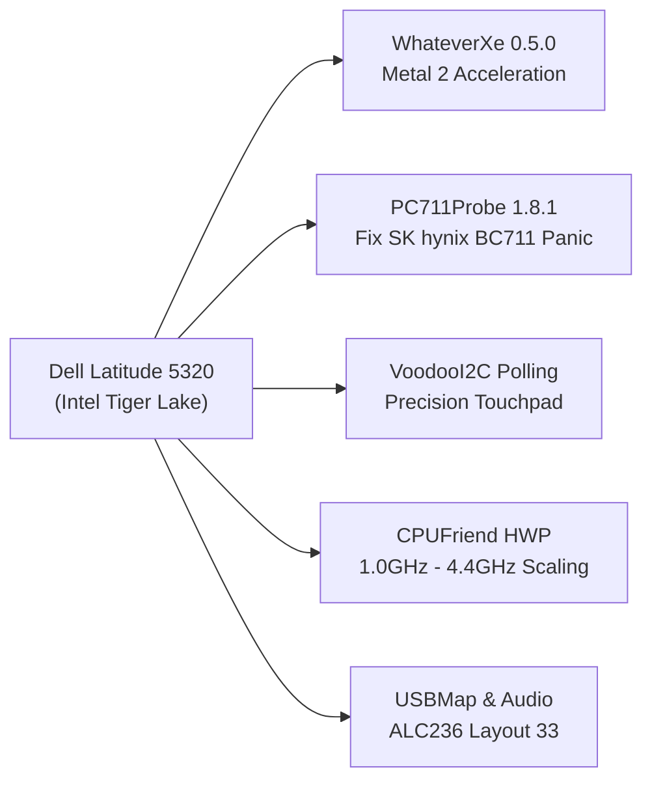

# Dell Latitude 5320 Hackintosh — macOS 15 Sequoia (OpenCore 1.0.8)

[](https://github.com/acidanthera/OpenCorePkg)
[](https://www.apple.com/macos/)
[]()
[-blueviolet.svg)](https://github.com/b00t0x/WhateverXe)
[-brightgreen.svg)](https://github.com/hrx114514x/PC711Probe)
[]()

Bộ cấu hình **OpenCore EFI 1.0.8** hoàn chỉnh, đã được thẩm định và vận hành thực tế trên dòng laptop doanh nhân **Dell Latitude 5320**. Hỗ trợ đầy đủ môi trường **macOS Sequoia (15.8.1 - Build 24H32)** và **macOS Sonoma (14.x)** với tính năng tăng tốc đồ họa phần cứng **Metal 2 (Intel Iris Xe)**, vá lỗi ổ cứng NVMe **SK hynix BC711**, bàn phím, touchpad đa điểm mượt mà và quản lý nguồn điện tối ưu.

---

## 1. Thông Số Phần Cứng & Trạng Thái Hoạt Động (Hardware Status)

### 1.1. Bảng cấu hình chi tiết

| Thành phần linh kiện | Thông số chi tiết phần cứng | Nhận diện macOS / Controller | Trạng thái hoạt động |
|---|---|---|:---:|
| **Model máy** | Dell Latitude 5320 Laptop | SMBIOS: `MacBookPro16,2` |  Hoạt động hoàn hảo |
| **CPU** | Intel Core i5-1145G7 (Tiger Lake-U) | 4 Cores / 8 Threads, 2.60 GHz (Turbo 4.40 GHz) |  Nhận đủ xung, HWP active |
| **Đồ họa (iGPU)** | Intel Iris Xe Graphics G7 (96 EUs) | `8086:9A49` (VRAM cấp phát động 1536 MB) |  **Tăng tốc Metal 2 mượt mà** |
| **Màn hình** | 13.3" IPS Anti-Glare Full HD | 1920 x 1080 @ 60.00Hz ARGB8888 |  Hiển thị sắc nét, 60 FPS |
| **Bộ nhớ RAM** | 8 GB / 16 GB LPDDR4x / DDR4 3200MHz | Bus 3200 MHz kênh đôi (Dual Channel) |  Nhận chuẩn tốc độ |
| **Ổ cứng NVMe** | **SK hynix BC711** NVMe SSD 512GB | `1C5C:174A` (`HFM512GD3JX013N`, FW `HPS1`) |  **Đã vá triệt để lỗi panic** |
| **Âm thanh (Audio)** | Realtek ALC3254 (ALC236) | `AppleALC.kext` (Layout ID: `alcid=33`) |  Loa trong, Mic & Jack 3.5mm OK |
| **Wi-Fi** | Intel Wi-Fi 6 AX201 (CNVi) | `8086:a0f0` (Giao diện ảo `en0` qua `itlwm`) |  Kết nối ổn định với HeliPort |
| **Bluetooth** | Intel AX201 Bluetooth | `8087:0026` (USB cổng nội bộ `HS10`) |  Nhận diện đầy đủ, kết nối tốt |
| **Bàn phím** | Bàn phím Dell chuẩn PS/2 | `VoodooPS2Controller` + `VoodooPS2Keyboard` |  Gõ tốt, phím Fn & đèn nền OK |
| **Touchpad** | Dell Precision Touchpad (I2C HID) | `VoodooI2C` + `VoodooI2CHID` (`-vi2c-force-polling`) |  **Cử chỉ đa điểm 1-2-3 ngón cực nhạy** |
| **Webcam** | Integrated_Webcam_HD | Cổng USB nội bộ `HS04` (`3141:27145`) |  FaceTime, Zoom, Photobooth OK |
| **Pin (Battery)** | 3-cell / 4-cell Li-ion | `SMCBatteryManager.kext` |  Báo chuẩn %, chu kỳ sạc, trạng thái AC |
| **Cổng kết nối USB** | USB 3.2 Gen 1 (Type-A) + Type-C / TB4 | `AppleUSBXHCI` (Bản đồ ánh xạ `USBMap.kext`) |  Tốc độ chuẩn USB 2.0 & SuperSpeed |
| **Cảm biến vân tay** | Broadcom 58200 Fingerprint | Cổng USB `HS05` (`2652:22595`) | ❌ Không hỗ trợ (Apple không hỗ trợ Touch ID ngoài) |

---

## 2. Các Đột Phá Kỹ Thuật Nổi Bật (Key Breakthroughs)



### 2.1. Đồ Họa Intel Iris Xe: Tăng Tốc Phần Cứng & Hỗ Trợ Metal 2
* **Bước đột phá:** Intel thế hệ 11 (Tiger Lake) vốn không được Apple hỗ trợ chính thức. Nhờ tích hợp kext chuyên sâu [`WhateverXe.kext`](https://github.com/b00t0x/WhateverXe) (phiên bản `0.5.0` bởi `b00t0x`) kết hợp cùng module `AppleIntelTGLCompat` và `AMFIPass.kext`, hệ thống đã kích hoạt thành công:
  - Khung kết xuất đồ họa **Metal 2** đầy đủ.
  - VRAM động lên đến **1536 MB**.
  - Độ phân giải gốc **Full HD 1080p @ 60Hz** mượt mà, loại bỏ hoàn toàn chế độ VESA giật lag.

### 2.2. Giải Cứu Ổ Cứng OEM SK hynix BC711 (`PC711Probe.kext`)
* **Vấn đề kinh điển:** Ổ cứng `SK hynix BC711` (`1C5C:174A`) đi kèm máy Dell thường gây lỗi treo timeout trong driver `AppleNVMeController`, dẫn tới Kernel Panic ngay sau mốc `[EB|#LOG:EXITBS:START]` khiến người dùng không thể cài macOS.
* **Giải pháp:** Tích hợp trực tiếp [`PC711Probe.kext`](https://github.com/hrx114514x/PC711Probe) phiên bản `v1.8.1` cùng boot-arg `-pc711pdbg`, giúp kiểm soát hàng đợi ngắt MSI-X, đảm bảo tốc độ đọc/ghi NVMe chuẩn PCIe Gen3 x4 ổn định dài lâu.

### 2.3. Touchpad Đa Điểm Siêu Mượt (`-vi2c-force-polling`)
* Bộ điều khiển touchpad giao tiếp I2C HID được điều khiển bởi hệ thống `VoodooI2C` + `VoodooI2CHID`.
* Bổ sung cờ `-vi2c-force-polling` giúp khắc phục triệt để hiện tượng rớt ngắt tín hiệu APIC/GPIO trên bo mạch Dell, đem lại cảm giác di chuột mượt mà, phản hồi tức thì và hỗ trợ trọn vẹn các cử chỉ macOS (cuộn trang tự nhiên, vuốt 3 ngón, phóng to thu nhỏ).

### 2.4. Quản Lý Nguồn CPU Tiger Lake Tối Ưu (HWP Speed Shift)
* Kết hợp `CPUFriend.kext` và bảng dữ liệu tùy chỉnh `CPUFriendDataProvider.kext`, thiết lập xung sàn 1.0 GHz và trần 4.4 GHz. Quản lý năng lượng tự động thích ứng giúp máy mát mẻ khi làm việc nhẹ và bung hết hiệu năng khi xử lý tác vụ nặng.

### 2.5. Bluetooth không tự tắt (`btpin`)
* **Vấn đề:** `BlueToolFixup` vá `/usr/sbin/bluetoothd` ngay trong bộ nhớ đệm file. File này được nén theo khối 16 KB trên phân vùng hệ thống đã niêm phong. Khi một phần khối bị đẩy ra khỏi RAM rồi nạp lại, APFS kiểm tra cả khối cùng trang đã vá, báo `Data hash mismatch`, và `bluetoothd` chết với `SIGBUS KERN_MEMORY_ERROR` khiến Bluetooth tự tắt.
* **Giải pháp:** [`PostInstall/Tools/btpin.c`](PostInstall/Tools/btpin.c) tìm các khối chứa chỗ vá và khóa chúng trong RAM (`mlock`, khoảng 96 KB), để chúng không bao giờ bị nạp lại.
* `BTLEAdvFixup` (đi kèm ForbiddenItlwm để có AirDrop) cũng vá `bluetoothd` theo cùng cách, ở khối `0x3A4000` và `0x4A0000`. Từ 16/11 Bluetooth chết lại vì btpin chưa khóa hai khối này; btpin bản 2026-11-18 đã thêm mẫu của nó, `btpin -n` liệt kê 6 khối. Sau khi cập nhật, chạy lại lệnh cài bên dưới. Cài một lần sau khi cài macOS:
  ```bash
  sudo sh PostInstall/Tools/install_btpin.sh
  ```

### 2.6. AirPlay phản chiếu iPhone sang Mac bị đen (`airplayfix`)
* **Vấn đề:** bộ thu AirPlay giải mã video ra định dạng 420v, WindowServer phải đổi sang BGRA bằng GVA nhưng driver Intel Tiger Lake không làm được, nên hình đen (chỉ hiện khi có lớp khác như nút X cùng được composite). Phản chiếu vẫn kết nối bình thường, chỉ thiếu hình.
* **Giải pháp:** [`PostInstall/Tools/airplayfix/`](PostInstall/Tools/airplayfix/) biên dịch một thư viện nhỏ ép bộ thu (chạy trong ControlCenter) xuất BGRA, đặt `enableGVATransfer=NO` để VideoToolbox đổi định dạng bằng CPU (đổi bằng GPU làm treo GPU), rồi cài LaunchAgent tự áp dụng mỗi lần đăng nhập. Cần boot-arg `amfi_get_out_of_my_way=0x1` (đã có trong EFI này; dạng có dấu gạch `-amfi_get_out_of_my_way` không được kernel đọc). Cài một lần sau khi cài macOS, **không dùng sudo**:
  ```bash
  sh PostInstall/Tools/airplayfix/install_airplayfix.sh
  ```
  Gỡ bỏ: `sh PostInstall/Tools/airplayfix/uninstall_airplayfix.sh`. Không cài thì EFI vẫn chạy bình thường, chỉ AirPlay mirroring bị đen.

### 2.7. iPhone Mirroring (app "iPhone Mirroring"): chỉ chạy được qua công cụ Mirra
* **Cập nhật 2026-11-21:** với [Mirra](https://github.com/eiyuumiru/Mirra) (cần iPhone đã jailbreak, kết nối điều khiển qua USB, video đi qua `awdl0`), iPhone Mirroring lên hình trên máy này, hơi giật do đường Wi-Fi/AWDL. Cần `amfi_get_out_of_my_way=0x1` (để hook nạp được vào app có library-validation) và `-wexnohwdecode` (iPhone gửi H.264 thay vì HEVC). Hook giải mã của Mirra (gỡ cờ FLS cho luồng Display P3) mặc định chỉ bật cho macOS build 25G332; máy này là 25G241 nên phải thêm `25G241` vào `INSPECTED_BUILD` trong `scripts/decoder.py` của Mirra (và cập nhật hash trong `manifest.json`), và việc này mất khi Mirra cập nhật. Không có hook, giải mã lỗi `-8969` và cửa sổ không có hình.
* Phần dưới đây là kết quả cũ khi chỉ dùng Bluetooth gốc của Apple, không qua Mirra:
* Máy báo "Không thể kết nối với iPhone" sau khi nhập passcode. `bluetoothd` thử kết nối Bluetooth LE tới iPhone nhưng controller AX201 không bao giờ nối được tới thiết bị Apple (kết nối tới tai nghe BLE thường vẫn bình thường). Đã thử tắt `BTLEAdvFixup` và để iPhone sáng màn hình, kết quả không đổi. Tính năng này chính thức chỉ dành cho Mac Apple Silicon hoặc Intel có T2, nên coi là không hỗ trợ.
* Phản chiếu màn hình iPhone lên Mac bằng AirPlay thì dùng được (xem mục 2.6).

### 2.8. CPU bị kẹp xuống 360 MHz từng đợt (`SSDT-PL1`, đã bật sẵn)
* Triệu chứng: dưới tải kéo dài, `powermetrics` báo `CPU LIMIT PL1`; xung tụt về khoảng 360 MHz trong 20–30 giây rồi hồi lại, lặp lại khoảng 90 giây một lần. Nhiệt lúc đó chỉ khoảng 50 °C, nên đây là giới hạn công suất PL1 của firmware (khoảng 12.5 W), không phải nhiệt.
* Cách sửa: `EFI/OC/ACPI/SSDT-PL1.aml` (bản sao ở `PostInstall/Tools/pl1/SSDT-PL1.aml`) (mã nguồn `SSDT-PL1.dsl`) ghi PACKAGE_RAPL_LIMIT qua MCHBAR một lần lúc khởi động: PL1 = 18 W, PL2 = 28 W. Chỉ nâng, không bao giờ hạ, và bỏ qua nếu BIOS đã khóa thanh ghi (bit 63) hoặc vùng MMIO không hợp lệ. 18 W là mức Notebookcheck đo duy trì được trên cùng khung máy ở chế độ Ultra Performance của Windows.
* **Nguyên nhân thật của chu kỳ ~35 s ở 18 W rồi ~22 s ở ~5,8 W / 400 MHz** là thanh ghi EC `0x32` (DPTF mode) bằng 0: firmware Dell chỉ gọi `DPST(1)` khi OS khai báo có driver Intel DTT (Windows có, macOS không). Khi đó nền tảng tự kẹp PL1 theo chu kỳ (MSR `0x64F` báo PL1 ở cả hai pha, không phải nhiệt). `EFI/OC/ACPI/SSDT-ECDPTF.aml` (mã nguồn `PostInstall/Tools/ecdptf/SSDT-ECDPTF.dsl`) gọi `DPST(1)` lúc khởi động, chỉ khi thanh ghi chưa bằng 1. Đo 200 s tải 8 luồng: giữ 18 W, ratio 32-34, không còn pha rớt.
* Đã nằm trong `EFI/OC/ACPI/` và bật trong `ACPI > Add` của `config.plist`. Muốn tắt: đặt `Enabled` của `SSDT-PL1.aml` về `false`. Muốn đổi mức công suất: sửa `PL1W` / `PL2W` trong `SSDT-PL1.dsl` rồi biên dịch lại bằng `iasl`.
* Kết quả đo trên máy này (5 phút dùng bình thường, cùng cấu hình, chỉ khác SSDT): thời gian bị kẹp dưới 1.5 GHz giảm từ 31% xuống 8%, công suất gói duy trì khoảng 18 W, nhiệt giữ ổn định khoảng 78 °C. Burst PL2 có thể chạm 100 °C trong khoảng 15 giây.
* Hạn chế: vẫn còn thỉnh thoảng một đợt kẹp khoảng 20 giây ở khoảng 6 W / 50 °C với PL1 đang là 18 W, nên không phải do SSDT này; chưa rõ nguyên nhân (nghi giới hạn nền tảng của EC). Nhiệt và quạt cao hơn khi giữ 18 W.

### 2.9. Sleep bằng Deep Idle (`S0ixStandby.kext`)
* Firmware của máy chỉ có Modern Standby (`SS3 = 0`), không có S3; S3 giả bằng `SSDT-S3` chỉ cho màn hình đen và hibernation S4 không resume được. Cấu hình hiện tại thay bằng Deep Idle: macOS ngủ ở S0, và `S0ixStandby.kext` (labrouss/S0ixStandby 0.5.4, BSD-3, dựng từ mã nguồn) gọi `_DSM` Modern Standby của firmware.
* Gồm: `S0ixStandby.kext`, `SSDT-DEEPIDLE.aml`, `SSDT-PEPD-STA.aml` (cho `\_SB.PEPD` hiện ra với macOS) cùng bản vá OpenCore đổi tên `PEPD._STA` thành `XSTA`; `SSDT-S3.aml` được tắt; `Cpuid1Data` giả Ice Lake (`E5060700`); boot-args `-s0ixdbg -s0ixacnortc`. Mã nguồn SSDT ở `PostInstall/Tools/s0ix/`.
* Kiểm tra: không có thành phần nào ở đây gây tụt xung. Cú kẹp ở mục 2.8 là giới hạn công suất, có trước khi bật Deep Idle và đo được nguyên như vậy trên cả hai cấu hình.
* Chi tiết quá trình thử và các hạn chế đã ghi nhận lúc đó nằm trong `HANDOFF_CONTEXT.md` (mục S0ixStandby).

---

## 3. Cấu Trúc Thư Mục EFI Chuẩn

```text
EFI/
├── BOOT/
│   └── BOOTx64.efi
└── OC/
    ├── ACPI/
    │   ├── SSDT-EC-USBX-LAPTOP.aml          # Tạo thiết bị giả lập EC & cấp nguồn USB
    │   ├── SSDT-DEEPIDLE.aml                # Khai báo Deep Idle cho S0ixStandby
    │   ├── SSDT-PEPD-STA.aml                # Cho thiết bị PEPD (Modern Standby) hiện với macOS
    │   ├── SSDT-PL1.aml                     # Nâng PL1/PL2 của gói CPU lúc khởi động (mục 2.8)
    │   └── SSDT-ECDPTF.aml                  # Đặt DPTF mode của EC, hết kẹp PL1 theo chu kỳ (mục 2.8)
    ├── Drivers/
    │   ├── HfsPlus.efi                      # Driver đọc phân vùng macOS HFS+
    │   ├── OpenCanopy.efi                   # Giao diện đồ họa OpenCore (tùy chọn)
    │   ├── OpenRuntime.efi                  # Driver runtime cốt lõi OpenCore
    │   ├── ResetNvramEntry.efi              # Tiện ích xóa nhanh biến NVRAM
    │   └── ToggleSipEntry.efi               # Tiện ích bật/tắt nhanh SIP
    ├── Kexts/
    │   ├── Lilu.kext (v1.7.2)               # Kext nền tảng
    │   ├── CPUFriend.kext (v1.3.0)          # Tối ưu hóa xung nhịp CPU
    │   ├── CPUFriendDataProvider.kext       # Bảng vector tần số CPU Tiger Lake
    │   ├── VirtualSMC.kext                  # Giả lập Apple SMC
    │   ├── WhateverXe.kext (v0.8.3)         # Driver tăng tốc iGPU Intel Iris Xe
    │   ├── S0ixStandby.kext (v0.5.4)        # Sleep Deep Idle qua Modern Standby (mục 2.9)
    │   ├── AMFIPass.kext                    # Vượt qua rào cản AMFI trên macOS 15
    │   ├── PC711Probe.kext (v1.8.1)         # Bản vá lỗi NVMe SK hynix BC711
    │   ├── AppleALC.kext (v1.9.8)           # Quản lý âm thanh Realtek ALC236
    │   ├── SMCBatteryManager.kext           # Giám sát trạng thái pin
    │   ├── VoodooPS2Controller.kext         # Bàn phím PS/2 & phím Fn
    │   ├── VoodooI2C.kext + plugins         # Core xử lý Touchpad I2C
    │   ├── VoodooI2CHID.kext                # Driver vệ tinh cho Touchpad HID
    │   ├── itlwm.kext                       # Driver Wi-Fi Intel cho Sequoia
    │   ├── USBMap.kext                      # Bảng định tuyến cổng USB chuẩn hóa
    │   ├── XHCI-unsupported.kext            # Hỗ trợ mở rộng XHCI chipset Intel
    │   ├── BlueToolFixup.kext               # Bản vá ngăn xếp Bluetooth macOS 15
    │   ├── IntelBTPatcher.kext              # Vá lỗi firmware Bluetooth
    │   └── IntelBluetoothFirmware.kext      # Firmware nạp cho Intel Bluetooth
    ├── OpenCore.efi
    └── config.plist
```

---

## 4. Thiết Lập BIOS Khuyến Nghị (Dell Latitude 5320)

Khởi động máy và nhấn liên tục phím **`F2`** để vào Dell BIOS Setup (đã kiểm tra trên BIOS `1.52.0`):

* **System Configuration:**
  - `SATA / NVMe Operation`: **`AHCI / NVMe`** *(BẮT BUỘC — Không để RAID On)*.
  - `Enable Camera`: **Enabled**.
* **Security:**
  - `Secure Boot`: **Disabled** *(BẮT BUỘC)*.
  - `Intel SGX`: **Disabled**.
* **Pre-boot Behavior:**
  - `Fastboot`: **`Thorough`** *(Giúp BIOS nạp đầy đủ thiết bị phần cứng trước khi boot)*.
* **Virtualization Support:**
  - `Intel VT-x`: **Enabled**.
  - `Intel VT-d`: **Enabled**.

> Xem cẩm nang hướng dẫn BIOS chi tiết tại: [docs/BIOS_CONFIGURATION.md](docs/BIOS_CONFIGURATION.md).

---

## 5. Hướng Dẫn Cài Đặt (Installation Guide)

> [!IMPORTANT]
> **Tạo thông tin SMBIOS riêng biệt:**
> File `config.plist` trong repo đã được ẩn các mã định danh cá nhân (`SystemSerialNumber = C02XXXXXXXXX`, `SystemUUID = 00000000-...`, `MLB = C02XXXXXXXXXXXXXX`). Trước khi sử dụng lâu dài và đăng nhập Apple ID, vui lòng dùng công cụ [GenSMBIOS](https://github.com/corpnewt/GenSMBIOS) tạo profile mới cho model **`MacBookPro16,2`** và điền vào mục `PlatformInfo -> Generic`.

### 5.1. Chuẩn bị USB Boot
1. Chuẩn bị một USB có dung lượng từ 16GB trở lên.
2. Tạo bộ cài macOS Sequoia hoặc Sonoma chính thức bằng lệnh `createinstallmedia` của Apple.
3. Dùng công cụ (như MountEFI hoặc ESP Mounter Pro) mount phân vùng EFI của USB.
4. Chép nguyên vẹn thư mục `EFI` từ kho lưu trữ này vào phân vùng EFI của USB.

### 5.2. Các bước tiến hành trên Dell Latitude 5320
1. Cắm USB vào cổng Type-A bên phải máy.
2. Bật nguồn và nhấn liên tục **`F12`** để mở Boot Menu của Dell.
3. Chọn boot vào thiết bị USB ở chế độ UEFI.
4. Tại menu boot OpenCore:
   - Dùng phím mũi tên chọn mục **`Reset NVRAM`** và nhấn Enter để xóa sạch các thiết lập NVRAM cũ.
   - Máy sẽ tự reboot → Nhấn tiếp **`F12`** → Chọn lại USB.
   - Chọn mục **`Install macOS Sequoia`** để khởi chạy bộ cài.
5. Định dạng ổ cứng theo chuẩn **APFS / GUID Partition Map** trong Disk Utility và tiến hành cài đặt như máy Mac thật.

---

## 6. Lưu Ý Hậu Cài Đặt & Quản Lý Nguồn Điện (Post-Install)

### 6.1. Kết nối Mạng Wi-Fi (AirportItlwm Native — laobamac)
* Hệ thống đã kích hoạt kext **`AirportItlwm.kext` (v2.4.0-alpha)** từ dự án [laobamac/itlwm](https://github.com/laobamac/itlwm) dành riêng cho macOS 15 Sequoia.
* Wi-Fi hoạt động trực tiếp qua giao diện Control Center / Menu Bar gốc của macOS, hỗ trợ quét sóng, lưu mật khẩu vào iCloud Keychain và cung cấp dịch vụ định vị (Location Services) cho Apple Maps / Find My.
* Tích hợp boot-arg **`itlwm_he=1`** để mở khóa chuẩn Wi-Fi 6 (802.11ax / High Efficiency) trên card Intel AX201.
* *Lưu ý:* Không cần chạy ứng dụng HeliPort.

### 6.2. Thiết lập Display Sleep chống treo máy
Do driver đồ họa Intel Iris Xe trên Tiger Lake chưa có vi mã gốc từ Apple, quá trình ngủ sâu S3 đôi khi gặp hiện tượng chậm phản hồi (framebuffer slow ack). Để đảm bảo máy sử dụng ổn định không lo đơ cứng:

Chạy lệnh tối ưu hóa chế độ Tắt Màn Hình (Display Sleep) trong Terminal:
```bash
sudo pmset -a sleep 0
sudo pmset -a displaysleep 5
sudo pmset -a hibernatemode 0
sudo pmset -a standby 0
sudo pmset -a autopoweroff 0
sudo pmset -a womp 0
sudo pmset -a powernap 0
sudo pmset -a proximitywake 0
sudo pmset -a tcpkeepalive 0
```
> Xem phân tích chuyên sâu về quản lý nguồn điện tại: [docs/SLEEP_AND_POWER_MANAGEMENT.md](docs/SLEEP_AND_POWER_MANAGEMENT.md).

---

## 7. Tài Liệu Kỹ Thuật Đính Kèm (Documentation Hub)

Để tìm hiểu chi tiết từng khía cạnh kỹ thuật, bạn có thể tham khảo các tài liệu chuyên đề trong thư mục `docs/`:

* 📖 [**HARDWARE_AND_PATCHES.md**](docs/HARDWARE_AND_PATCHES.md): Phân tích toàn bộ 15 boot-args, kiến trúc WhateverXe, bản vá NVMe PC711Probe và bản đồ cổng USB.
* ⚡ [**SLEEP_AND_POWER_MANAGEMENT.md**](docs/SLEEP_AND_POWER_MANAGEMENT.md): Chi tiết cơ chế sleep, nguyên nhân deadlock và cẩm nang cấu hình pmset.
* 🛠️ [**BIOS_CONFIGURATION.md**](docs/BIOS_CONFIGURATION.md): Hướng dẫn từng bước thiết lập Dell BIOS Setup (v1.52.0+).
* 📝 [**WALKTHROUGH.md**](docs/WALKTHROUGH.md): Nhật ký kiểm định các layout âm thanh AppleALC (`alcid=33`).
* 📡 [**AIRDROP.md**](docs/AIRDROP.md): AirDrop (AWDL) trên Intel AX201 bằng ForbiddenItlwm, cấu hình, bước bật `wifip2pd` và giới hạn đã biết.

---

## 8. Lời Cảm Ơn & Giấy Phép (Credits & License)

Dự án này được xây dựng dựa trên sự cống hiến to lớn của cộng đồng Hackintosh toàn cầu:
* [Acidanthera](https://github.com/acidanthera) cho dự án OpenCorePkg, Lilu, VirtualSMC, AppleALC, VoodooPS2Controller và BlueToolFixup.
* [b00t0x](https://github.com/b00t0x) cho dự án đột phá `WhateverXe` mang đồ họa Intel Iris Xe (Tiger Lake) lên macOS.
* [hrx114514x](https://github.com/hrx114514x/PC711Probe) & `stationk9` cho kext `PC711Probe` khắc phục triệt để lỗi NVMe SK hynix BC711.
* [OpenIntelWireless](https://github.com/OpenIntelWireless) cho driver Wi-Fi `itlwm` và `IntelBluetoothFirmware`.
* [alexandred](https://github.com/alexandred) & đội ngũ [VoodooI2C](https://github.com/VoodooI2C/VoodooI2C) cho hệ thống driver Touchpad I2C mượt mà.
* Tác giả và người bảo trì: [@gianguyen14](https://github.com/gianguyen14).

Dự án phát hành dưới giấy phép [MIT License](LICENSE).
